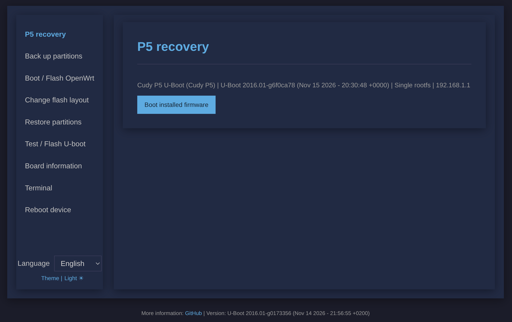
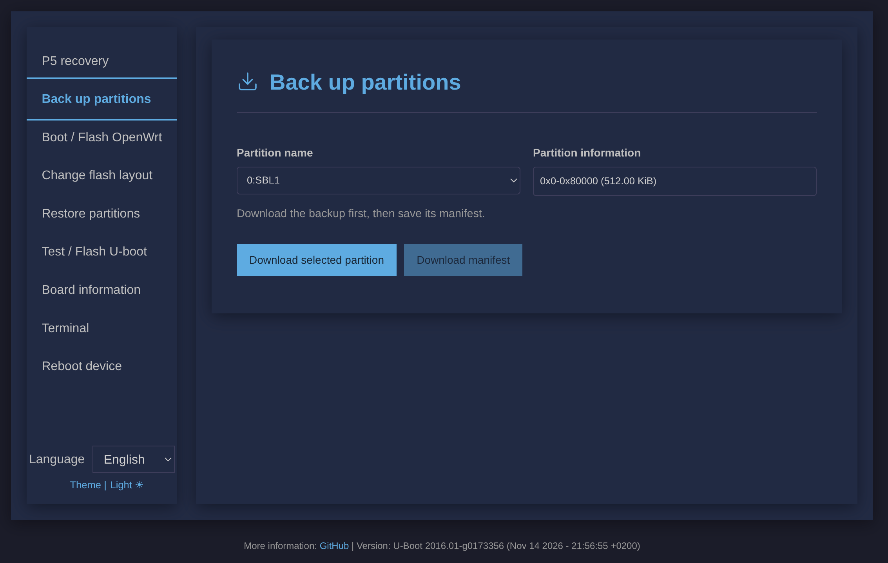
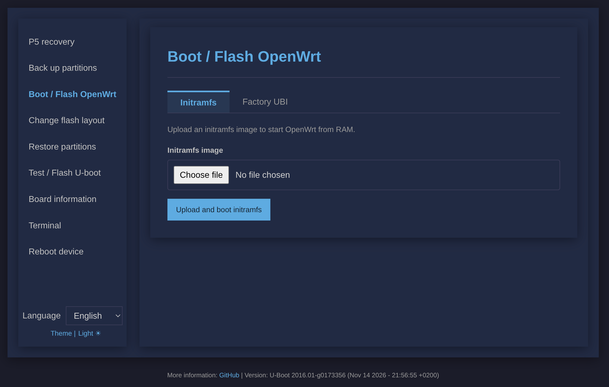
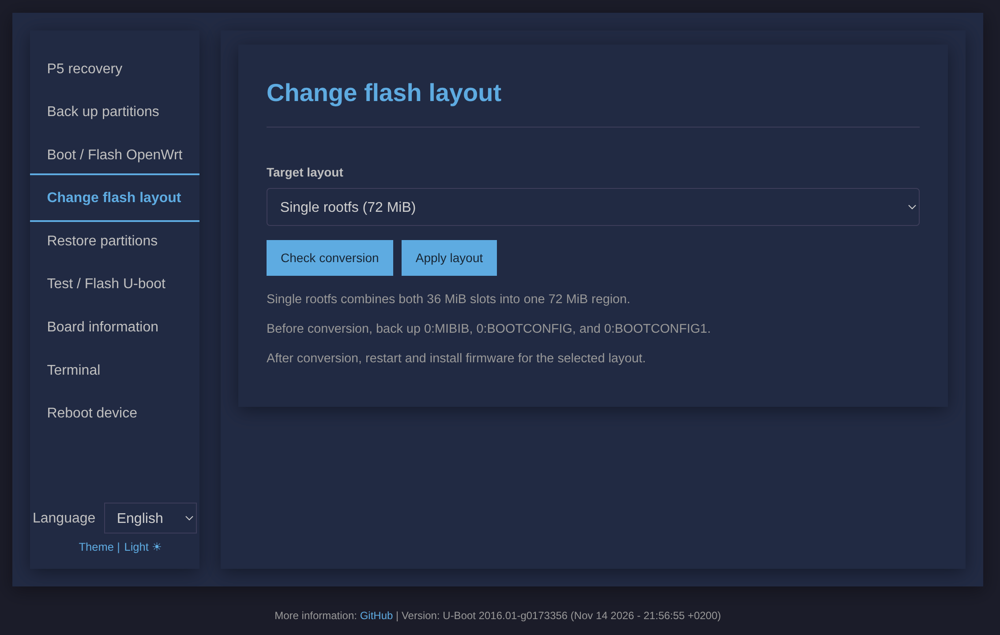
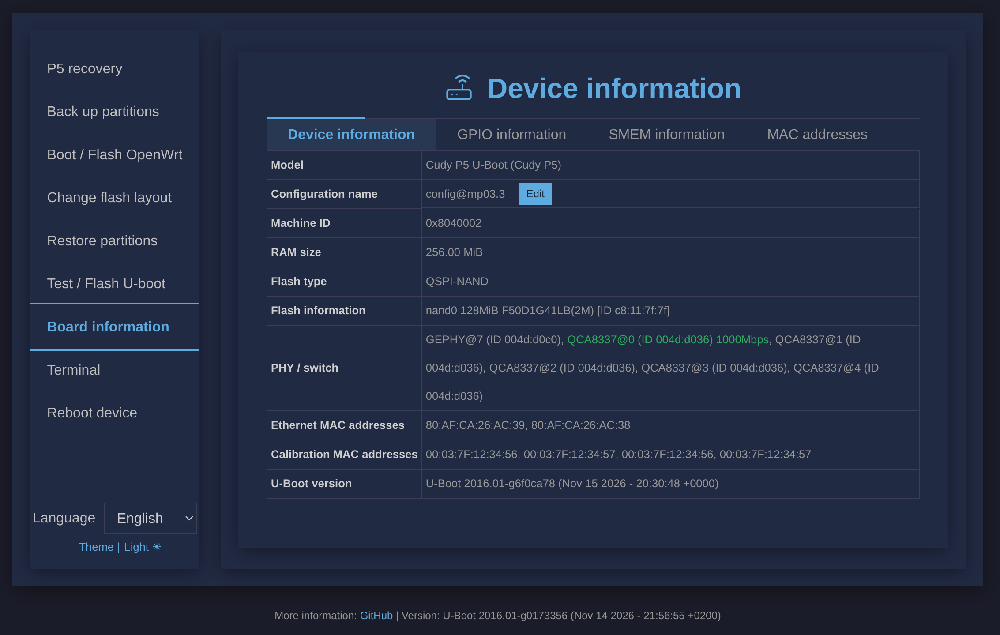

# ubootP5webui

Custom U-Boot and web recovery for the Cudy P5 with 256 MiB RAM and 128 MiB NAND.
The WebUI supports English and Chinese.

## Screenshots

Screenshots from a real Cudy P5. Select an image for full size.

<table>
<tr><th>Recovery</th><th>Backups</th><th>Boot OpenWrt</th><th>Flash layout</th><th>Device information</th></tr>
<tr>
<td></td>
<td></td>
<td></td>
<td></td>
<td></td>
</tr>
</table>

## Start here

- [Install or RAM-test U-Boot](INSTALL.md), including backups, image selection, and checksum commands.
- [Download CI artifacts](https://github.com/MayorBug/ubootP5webui/actions/workflows/build-p5.yml) from a successful manual run.
- [Build locally and run host tests](tools/p5/README.md) with the pinned toolchain and dependencies.

## Project status

Hardware results came from one P5. Simulated tests do not establish hardware behavior.

| Status | Coverage |
|---|---|
| Hardware-tested | RAM boot, Ethernet/DHCP, web recovery, NAND/partition backups, initramfs and installed OpenWrt boot. |
| Hardware-tested | APPSBL installation with readback and SBL startup, earlier dual-to-single conversion, and single-layout factory UBI flashing. |
| Simulated only | BOOTCONFIG normalization, conversion back to dual, guided restore, and factory UBI on both dual slots. |
| Unsupported | Raw OOB replay, one-step full NAND restore, and guided writes to NAND targets with bad blocks. |

## Choose an image

| Image | Use |
|---|---|
| `p5-ramtest-NOT-FOR-FLASH.elf` | Stock U-Boot `bootelf -s` or the custom recovery RAM-test page. Never flash it. |
| `p5-uboot.mbn` | Custom recovery RAM test or permanent installation. |

See [artifact paths and checksums](INSTALL.md#1-prepare-the-files) before using downloaded or locally built images.
The dedicated installer replaces APPSBL and checks complete readback. It preserves APPSBL_1, environment, firmware, calibration, and identity.

## Recovery essentials

### Start recovery without UART

After installing this U-Boot, use either button to open web recovery.

1. Connect your PC to a LAN port.
2. Set the PC to obtain its IP address automatically.
3. Switch on or restart the router. The blue power LED blinks during the boot countdown.
4. During the countdown, press WPS or Reset. You can also hold either button while you switch on the router.
5. When the red Internet LED stays on, release the button.
6. Open [http://192.168.1.1/](http://192.168.1.1/) in your browser.

U-Boot sets up the LAN and gives your PC an IP address automatically.
You do not need UART or a manual IP address for this method.
If the PC keeps its old address, reconnect the LAN cable.

### Recovery tools

- The web terminal accepts unrestricted U-Boot commands, including flash writes. Use recovery only on a trusted local network.
- The modem stays off by default. Use a matching OpenWrt kernel that enables modem power.
- Factory UBI uploads must match the board and current layout and fit within 32 MiB. See [image requirements](INSTALL.md#direct-factory-ubi).

The original layout has two 36 MiB firmware regions. Single rootfs combines them into 72 MiB.
Single-layout conversion sets both BOOTCONFIG copies to primary rootfs when needed, then updates MIBIB.
It does not rewrite firmware data. Restart after conversion, then install firmware for the selected layout.
See [layout and repair instructions](INSTALL.md#5-choose-the-openwrt-layout).

Modem startup switches save actions for the next boot. Manual power and reset controls interrupt the connection.
GPIO output values show the configured latch, not measured voltage. The LED has On/Off, Blink, and Stop controls.

## Development

The [manual workflow](.github/workflows/build-p5.yml) builds both images and runs host and browser tests.
Local scripts only build files. Each exported image directory includes `SHA256SUMS` and `memory-report.txt`.
The memory report excludes live heap and stack use.
Keep generated images, backups, logs, and toolchains out of Git.

## Source and license

Based on [Cathgao/u-boot-2016](https://github.com/Cathgao/u-boot-2016), commit `03ec79d`.
The [upstream Chinese README](README.upstream.zh-CN.md) credits earlier work by
[1980490718](https://github.com/1980490718/u-boot-2016) and Qualcomm QSDK.
See [LICENSE](LICENSE), [Licenses](Licenses), and source copyright notices.
